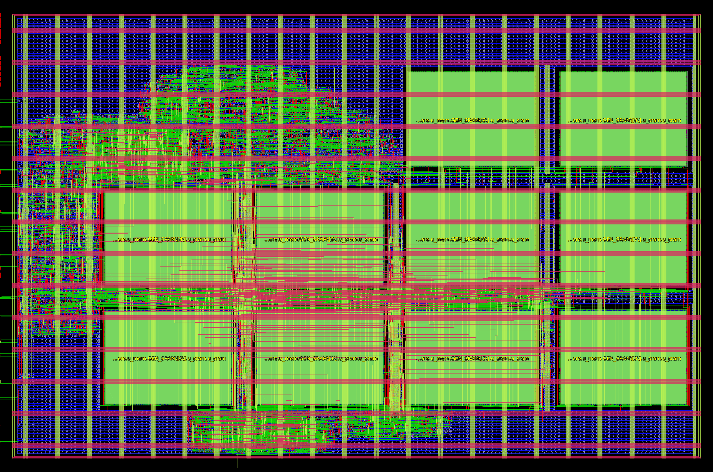

# mb_chip physical signoff (Phase 3)

**Status (2026-10-13):**
- `mb_chip` is hardened and signed off in run `src/flow/runs/mb_final`.
  - Flow: `src/flow/` (LibreLane 3.0.14 Classic, gf180mcuD open_pdks 7b70722e + `gf180mcu_as_sc_mcu7t3v3`).
  - Build command: `src/flow/build.sh mb_final`.
  - Run directories are git-ignored.
- The routed netlist passes gate-level simulation bit-exact on every logit. See [GLS](#gate-level-simulation).
- Timing-annotated GLS (2026-10-14): 31 tokens bit-exact at min_ff / nom_tt / max_ss with the signoff SDF.
  - All timing checks are active and 100 % annotated, with 0 violations.
  - The negative tests fire as expected.
  - See [Timing-annotated GLS](#timing-annotated-gls).
- Activity-based power (2026-10-14): 18.2 mW = 583 uJ/token at nom tt (21.6 ff, 15.2 ss). See [Activity-based power](#activity-based-power).
- Metal fill (2026-10-14): the deliverable is `final/gds_filled/mb_chip.gds`, from `src/flow/fill/fill.sh mb_final`. On it, KLayout main / antenna / Vn.2b / dummy rules = 0, Magic DRC 0, GDS-extracted LVS matches, and STA with fill is still clean. See [Metal fill and density](#metal-fill-and-density).
- Not committed.



`mb_chip_layout.png` is the OpenROAD render of `final/odb` (`src/flow/report/render.tcl`). LibreLane's KLayout render, with fill included, is `runs/mb_final/final/render/mb_chip.png`.

## Floorplan
- **Die and core:** the same as `dla_fp16_chip`. Die 1675 x 1110 um, core [40, 40, 1635, 1070], `A56_ACV.def` west-edge pin template, DVDD/DVSS core ring and power-pin weld (`librelane/connect_power.py`). The die did not grow.
- **Macros:** 10 x `gf180mcu_ocd_ip_sram__sram256x8m8wm1` (301.3 x 224.9 um, pins on the south edge), all orientation N.
  - They keep the FP16 column x positions (244.90 / 601.20 / 957.50 / 1313.80) and its 279.93 um row pitch (55 um channels).
  - There are three rows instead of two. The grid is shifted down 140 um so all three fit in the core.

| Row | y (um) | Instances (`u_core.u_mem.GEN_SRAM[i].u_sram.u_sram`) |
|---|---|---|
| 2 (top) | 717.43 | [8], [9] (pair 4) in the two east columns |
| 1 | 437.50 | [4..7] (pairs 2, 3) |
| 0 | 157.57 | [0..3] (pairs 0, 1) |

- **Standard cells** sit in three places:
  - the free NW pocket (x 40..947, y 717..1070);
  - the ~205 um west channel next to the pins;
  - the 117 um strip under row 0, which is also where row 0's pins escape.
- **Why 4+4+2 and not 5+5:** 5 columns need 1,507 um of macro width alone, or ≥ 1,627 um with even 30 um channels, which is more than the 1,595 um core width.

## Flow deltas vs the FP16 flow (`librelane/config_fp16.yaml`)
Unchanged from FP16:
- die, core, template, PDN (`librelane/pdn_cfg.tcl`), routing obstruction and 40 ns clock;
- antenna settings: no heuristic diodes, GRT margin 75, `DRT_ANTENNA_REPAIR_ITERS=3`, `JUMPER_ONLY=false`;
- slew/cap recipe: PnR SDC at 0.9 ns / 0.12 pF, post-GRT design repair at 40/30 %, 500 um wire buffering, CTS clusters of 12 / 50 um;
- placement density 50 %;
- SDC split: `PNR_SDC_FILE` plus an explicit `SIGNOFF_SDC_FILE`.

New in this flow:
- **RTL and macros:** `src/rtl/chip.f` plus include dirs `nonlin/` and `seq/`, and 10 macro instances on the 3-row grid above.
- **SDCs:** the two SDCs share one body. `src/flow/sdc/base.sdc` is wrapped by `pnr.sdc` and `signoff.sdc`, and these set the limits.
- **Signoff checks outside LibreLane** (`src/flow/drc/kdrc.sh`): LibreLane 3.0.14 skips KLayout.DRC for gf180mcuD, so the foundry KLayout deck and the Vn.2b via-array check run on the final GDS, as in the FP16 signoff. The python env and the version/deck pins are in `src/flow/drc/` (see Reproduce).

**SRAM CEN hold (pre-layout -1.81 ns; macro hold 2.96 ns at ss).** This was fixed the same way as FP16: post-CTS resizer hold repair (`RUN_POST_CTS_RESIZER_TIMING`, margin 0.1 ns, all 9 corners, propagated clock).
- The repair inserted 280 hold buffers. The CEN paths now go through `dlybuff_2` chains.
- Routed SPEF slack on SRAM CEN: +0.82 ns at max_ss, where the library hold is 3.12 ns, and +1.01 ns at min_ff.

## Signoff metrics: `mb_final` vs `dla_fp16_chip` (`librelane/runs/fp16_final`)

| Metric | mb_chip (mb_final) | dla_fp16_chip (fp16_final) |
|---|---|---|
| SRAM macros | 10 (677,714 um^2) | 8 (542,171 um^2) |
| Std cells, excl. fill (incl. 7,249 / 7,984 tap) | 16,967 | 14,221 |
| Std-cell area | 244,062 um^2 | 176,720 um^2 |
| Flops / hold buffers / repair buffers / diodes | 672 / 280 / 1,656 / 1,395 | 485 / 213 / 995 / 826 |
| Utilization, incl. macros (std cells only) | 56.5 % (25.6 %) | 44.1 % (16.2 %) |
| Routed wirelength | 673.6 mm | 408.2 mm |
| Worst setup, SPEF, 9 corners | **+18.35 ns** (max_ss_125C_3v00, SRAM[1].Q → SRAM[7]) | +22.51 ns (max_ss) |
| Setup slack at nom tt / nom ff | +24.69 / +27.84 ns | +28.26 / +28.98 ns |
| Worst hold, SPEF, 9 corners | **+0.104 ns** (min_ff_n40C_3v60, flop to flop) | +0.104 ns (min_ff) |
| Hold slack at max_ss / nom tt | +0.35 / +0.20 ns | +0.19 / +0.20 ns |
| Setup / hold violations, all 9 corners | 0 / 0 | 0 / 0 |
| Max-slew violations @ 1.5 ns, all corners | 0 | 0 |
| Max-cap violations, liberty limits / 0.2 pF default (max_ss) | 0 / 18 | 0 / 18 |
| Clock skew, worst setup / hold | 0.45 / -0.54 ns | 0.52 / -0.54 ns |
| Power (vectorless, LibreLane `power__total` = **max_ss** corner; nom tt is 22.5 mW, see [Activity-based power](#activity-based-power)) | 19.4 mW | 124.3 mW |
| Power, nom tt, SDF-GLS activity (SAIF) | **18.2 mW = 583 uJ/token** (21.3 mW with the flop proxy) | - |
| Magic DRC / KLayout DRC main / KLayout antenna / Vn.2b | 0 / 0 / 0 / 0 | 0 / 0 / 0 / 0 |
| KLayout density, block bbox, unfilled GDS | 6 items (M1-M5, MT < 30 %) | 6 items |
| KLayout density, block bbox, **filled GDS** | 2 items (M2.4 23.8 %, M4.4 24.0 %): the DRM-legal maximum, see below | (no fill) |
| KLayout density, worst-case A56 die model, filled | 1 item (M1.4 29.51 %), cleared by ≥ 1.35 % M1 anywhere else on the die | - |
| LVS / XOR / illegal overlap | 0 (match) / 0 / 0 | 0 / 0 / 0 |
| OpenROAD antenna (post-DRT) | 0 nets / 0 pins | 0 / 0 |
| Route DRC | 0 | 0 |
| GLS of routed netlist | **nl + pnl PASS, 31 tokens x 128 logits bit-exact** | nl + pnl 16/16 images bit-exact |
| Run time, PnR + signoff STA | ~15 min | ~10 min |

Notes on the table:
- **0.2 pF column.** The 18 nets over 0.2 pF are:
  - the two SRAM clock-tree buffers (1.80 / 1.75 pF, each driving 5 SRAM CLK pins at 0.314 pF);
  - CTS leaf and trunk buffers;
  - a few nets at 0.20-0.22 pF.
  All of them are within their liberty `max_capacitance`. This is the same policy as FP16 (`docs/dla_fp16_chip.md`).
- **Power is lower than FP16 only because of vectorless estimation:**
  - FP16 ties every SRAM CEN low, so OpenSTA charges all 8 macros an access every cycle (macro power 135 mW).
  - In `mb_chip`, CEN is a logic net with the default 0.1 activity, so the macros contribute only ~0.13 mW. 62 % of the 22.5 mW (nom tt) is clock.
  - In real operation, one SRAM pair (2 of 10 macros) is enabled per memory access. The activity-based figure (SDF GLS, one token) is 18.2 mW at nom tt, with the SRAMs at 2.27 mW. See [Activity-based power](#activity-based-power).
- **IR drop** is not measured at block level (`RUN_IRDROP_REPORT: false`, as in FP16).

## Gate-level simulation
`src/flow/gls/run_gls.sh [nl|pnl]` runs `src/tb/chip/tb_mb_chip.sv` on the routed netlist:
- zero-delay Icarus simulation with the gf180mcu_as_sc_mcu7t3v3 cell models and the behavioural SRAM model;
- the same flow as `scripts/run_fp16_gls.sh`, which also runs without SDF;
- `nl` is the unpowered `final/nl`; `pnl` is the powered `final/pnl` (`-DUSE_POWER_PINS`).

The vectors are the RTL chip-TB default set: 2 stories, 31 tokens, with a state reset between them.

| Netlist | Result | Cycles/token (START→done) | Wall time |
|---|---|---|---|
| `final/nl` | **PASS**: 31 tokens x 128 logits bit-exact, 2 state resets, no pad contention | 801,056 (same as RTL) | 1 h 47 min |
| `final/pnl` | **PASS**: 31 tokens x 128 logits bit-exact | 801,056 | 1 h 39 min |

## Timing-annotated GLS

`src/flow/sdf_gls/run_sdf_gls.sh <corner>` runs the routed netlist (`final/nl`) with the
corner's SDF and every timing check active. This closes the "zero-delay GLS only" gap of the
hold margin (+0.104 ns STA at min_ff).

### Simulator and models
- **Simulator.** Icarus 13 parses `$setuphold`/`$width` but ignores them ("Timing checks are not
  supported"), so a clean Icarus run proves nothing about timing. The flow uses Open Source CVC
  7.00b (`tools/setup_cvc.sh`: pinned commit + `tools/cvc_sdf.patch`, built in
  `tools/.cvc`). Two SDF-reader bugs in CVC are fixed by the patch:
  1. the edge of a timing-check port (`(SETUP (posedge D) ...)`) was dropped, so the posedge-D
     and negedge-D checks of a flop both got the last value in the SDF;
  2. a leading `-` was applied only to integers: the negative hold limit `-0.066` was annotated
     as `+0.066` (false hold violations on 691 checks). Negative limits are now clamped to 0
     (CVC has no negative-timing-check support): conservative.
- **Std cells** (`models/gen_cells.py`). The AS 3V3 library Verilog has no specify blocks. The
  generator keeps each functional body and adds, from the tt Liberty: one specify path per
  timing arc; conditional paths for the pin pairs with both unate senses (xor2/xnor2 A,B; mux2 S),
  matched by `COND`s that `sdf/fix_sdf.py` adds to OpenSTA's two IOPATHs (order from
  `report_dcalc`, checked on one instance against the SDF values); `$setuphold` per data edge;
  `$width` high/low; a notifier that forces the flop state to X.
  - **CVC MIPD bypass (found during this work).** CVC applies an SDF INTERCONNECT (a port
    delay) to gates and continuous assigns but not to procedural reads of the port: a flop's
    `always @(posedge CLK)` fired at the undelayed edge, before the delayed CLK that the specify
    path is measured from, so every CLK->Q delay was silently 0 (found as 27 ps "hold margins"
    on the SCLK synchroniser). The models copy every input of a sequential cell through a
    continuous assign; `checks/model_selftest` tests this on every run (it fails on the
    uncorrected models).
  - `dfsrtp_2` (191 flops, async RN/SN = `rst_n`) has no recovery/removal arcs and no RN/SN->Q
    arcs in the Liberty. Neither STA nor the SDF covers reset release. The model has `$recrem`
    with fixed placeholder limits (recovery 1.0 ns, removal 2.5 ns, at or above the GF180 7t5v0
    `dffrsnq` ss values); the TB releases `rst_n` at the SDC input delay after a clock edge.
- **SRAM** (`models/sram_sdf.v`, a copy of the vendor model; header notes 1-6):
  - the vendor specparams are 5 V values (Tcyc 55.6 ns, Tckh/Tckl 25 ns, access 45 ns: they would
    flag every 40 ns cycle); they are replaced by the 3.3 V Liberty values (the SDF overrides
    them anyway);
  - the CEN setup/hold checks were qualified by `cen_flag` at the clock edge, which never checks
    a CEN fall just after an edge where CEN was high, i.e. exactly the CEN hold paths that needed
    repair. They are now unconditional once the macro is operational;
  - the inputs go through continuous assigns (MIPD bypass, as above; a `buf` instance array was
    tried first and made CVC drive one address bit wrong on SRAM 9: silent wrong reads);
  - the violation-message block waited on the notifiers, which crashes CVC compiled code; it now
    polls them (the std-cell notifier is read through a wire for the same reason).
  - A write keeps Q (datasheet truth table); the behavioural model of the zero-delay GLS reloads
    Q with the old word. The bit-exact SDF runs show the design never uses Q after a write.
- **Netlist.** `sdf/legal_netlist.py` renames the 10 escaped SRAM instances (CVC's SDF reader
  rejects an escaped instance followed by a bit-selected pin and then drops the rest of the file;
  `sdf/fix_sdf.py` renames them in the SDF too). Nets are not renamed.

### SDF and coverage
- `sdf/write_sdf.tcl` reruns the signoff STA of a corner with the same inputs as LibreLane step 76
  (`common/sta_corner.tcl`). It reproduces the signoff slacks (min_ff hold +0.1041 ns, max_ss setup
  +18.3457 ns, nom_tt +24.6938 / +0.2009 ns), and its `write_sdf -include_typ -divider .` output is
  byte-identical (except the date) to `runs/mb_final/final/sdf`. min_* runs use the SDF min
  values, nom_* typ, max_* max.
- The SDF has no derate and no clock uncertainty: the simulated margins are expected to be larger
  than the STA slacks by about 0.25 ns + 5 %.
- `checks/sdf_coverage.py` reads CVC's `+sdfverbose` log; a run fails unless it is 100 %:

| SDF statement | In SDF | Annotated |
|---|---|---|
| IOPATH | 19,077 | 19,077 |
| INTERCONNECT (19,979 internal, 20 from inputs, 53 to outputs) | 20,052 | 20,052 |
| SETUP / HOLD | 1,864 / 1,864 | 1,864 / 1,864 |
| WIDTH / PERIOD | 1,364 / 10 | 1,364 / 10 |
| **Total** | **44,231** | **44,231 (100 %)** |
| Instances with timing arcs (all 8,098 non-physical cells) | 8,098 | 8,098 |
| Model timing checks that got an SDF value | 3,758 | 3,758 (100 %) |

Not from the SDF: the 382 placeholder `$recrem` checks of `dfsrtp_2`. 691 negative hold limits
(of 1,864) are clamped to 0, which is pessimistic. Same numbers in every corner.

### Testbench and pad timing (`src/tb/sdf/`)
`tb_mb_chip_sdf.v` is the chip TB (`src/tb/chip`) in Verilog-2001, with the same checks, the same
vectors and the same bit-exact compare. Pad timing follows the signoff SDC (20 % of the period
for input and output delay, min = max):
- every host pad change is made 8 ns after a rising clk edge (the zero-delay TB used the
  falling edge);
- read data is sampled 32 ns after the launching edge (period - output delay);
- `io_mon.vh` flags any chip output change in the last 8 ns before an edge;
- HRDY is used one clk later than in the zero-delay TB, so a token takes 801,252 clk instead
  of 801,056 (one extra clk per HRDY wait, 195 per token).
The clock enters at the `clk` port. The whole CTS tree is in the SDF (propagated clock, as in STA).

### Results
Final runs (`build/sdf_gls/summary.rpt`) use the 31-token chip-TB set: 2 stories, state reset
before each, CSR reset-value / err_cmd checks, every token's 128 logits read back over RD_MEM_Q.

| Corner (SDF values) | Tokens bit-exact | Timing-check violations | SRAM model errors | Output-timing violations (worst output settle after clk, limit 32 ns) | SDF coverage | Sim time |
|---|---|---|---|---|---|---|
| **min_ff_n40C_3v60** (min) | **31 / 31** | **0** | 0 | 0 (2.50 ns) | 100 % | 2.6 h |
| **nom_tt_025C_3v30** (typ) | **31 / 31** | **0** | 0 | 0 (3.23 ns) | 100 % | 2.7 h |
| **max_ss_125C_3v00** (max) | **31 / 31** | **0** | 0 | 0 (4.42 ns) | 100 % | 2.8 h |
| nom_tt, powered netlist `final/pnl` | 2 / 2 | 0 | 0 | 0 (3.23 ns) | 100 % | 0.2 h |
| nom_tt / nom_ff / nom_ss power runs (below) | 2 / 2 each | 0 | 0 | 0 | 100 % | 0.3 h each |

Each run checks 801,252 clk per token START->done; the zero-delay GLS and RTL take 801,056 (see
the HRDY note above). The checks that ran are 1,344 flop `$setuphold` pairs, 1,344 `$width`, 382
`$recrem`, and 1,070 SRAM `$setup` / `$hold` / `$width` / `$period` (CEN, GWEN, WEN, A, D, CLK).

### Negative tests (the checks fire)
Each test is a short run of `run_sdf_gls.sh` on the 2-token story "On". Each must fail, and each does:

| Test | Edit | Result |
|---|---|---|
| SRAM hold, min_ff | SRAM 0 CLK pin +2.0 ns (`SKEW`) | **637 violations** (SRAM A setup/hold, the vendor-model X), 299 SRAM error messages, logits wrong |
| Flop hold, min_ff | `_11466_.CLK` +0.60 ns (observed margin 0.576 ns, limit 0.066 ns) | **115 hold violations** on `_11466_` |
| Synchroniser, min_ff | `_11729_.CLK` (SCLK sync) +0.55 ns | **149,630 setup violations**; the X it captures breaks the first CSR read |
| Setup, max_ss | clock 18 ns (STA at 18 ns: WNS -3.65 ns) | **687 setup violations** (register file `u_seq.u_rf`), logits wrong |

A flop-hold skew larger than the data-path delay (0.8 ns on `_11451_`) did NOT fire: the data
then changes before the late clock edge and meets setup. A clock skew can only be caught inside
the window (data delay - hold limit, data delay + setup limit). This is why the skews above are
chosen from the observed margins.

### Observed setup / hold margins (`checks/margin_probe.py`)
A clean run only says that no check fired. A probe run adds P ns to every HOLD (or SETUP) limit,
so every transition within P of its limit is reported with the measured separation; the
notifier effects are off (`MB_TCHK_PROBE`). One full token, reports before 1 us (power-up
X resolution) ignored:

| Probe | Corner | Checks reported (reports) | Worst observed margin | STA (signoff, with 0.25 ns uncertainty + 5 % derate) |
|---|---|---|---|---|
| HOLD +3.0 ns | min_ff | 1,476 (20.3 M) | **+0.447 ns** at `_11664_` (`u_csr.err_cmd`, D rise; STA path slack +0.17 ns). Next: `_11729_` SCLK synchroniser +0.484 ns (toggles every SCLK edge, 200 k reports) | worst hold +0.104 ns (`_11214_`, FIFO mux loop: not among the 40 worst observed checks, i.e. > +0.68 ns observed) |
| HOLD, SRAM pins | min_ff | 251 SRAM checks | **+1.071 ns** (SRAM 4 A[1], limit 0.60 ns); CEN hold above that | SRAM CEN hold +1.01 ns |
| SETUP +26 ns | max_ss | 138 (368 k) | **+20.85 ns** at `_11370_` (`u_seq.u_rf.r[3][11]`, from the host input data) | worst setup +18.35 ns (SRAM[1].Q -> SRAM[7].D, not exercised by the token) |
| SETUP, SRAM pins | max_ss | 2 | +24.96 ns (SRAM 7 CEN) | - |

The worst observed hold margin, +0.447 ns, is the STA path slack plus the uncertainty and derate
(0.17 + 0.25 + about 0.03 ns). The sim and the STA agree; the 0.1 ns repair margin is real
margin, not an artefact. Checks that were never reported have at least the probe margin (3 ns
hold, 26 ns setup). A probe only sees paths the token exercises. The STA-worst setup path (SRAM 1 -> 7) is
not exercised by the token. The STA-worst hold path (`_11214_`) is observed with more than
+0.68 ns in this token. The STA stays the authority for any path the vectors do not exercise.

## Activity-based power

`src/flow/power/run_power.sh` (about 35 min) computes the power from simulation activity.
- **Activity.** For each corner, the SDF GLS of the same corner (all glitches the SDF timing produces) runs the 2-token story "On": STATE_RESET, token 0 'O', token 1 'n'. The VCD covers all 8,345 mb_chip nets from START of token 1 to the end of its logit readback: 806,152 clk = 32.246 ms of streaming + compute + status + readback.
- **SAIF.** OpenSTA's `read_vcd`/`read_saif` annotate pins only. A net VCD of the flat netlist annotated just the 62 ports, so `activity/vcd2saif.py` writes one SAIF entry per instance pin. Annotated pins: 28,353 of 28,464. The other 111 are the dangling outputs of the CTS `clkload*` dummy cells, which have no net. So 100 % of connected pins and 100 % of nets are annotated.
- **Power.** `report/power.tcl` runs on the signoff netlist, SDC and SPEF of the corner (`common/sta_corner.tcl`).
- **Energy per token** = power x 32.04 ms (START->done).

| nom corner, SAIF activity [mW] | Sequential | Combinational | Clock | Macro (10 SRAM) | Total | Energy/token |
|---|---|---|---|---|---|---|
| **tt 25C 3.30 V** (internal / switching / leakage) | 0 / 0.052 / 0 | 1.265 / 0.727 / 0 | 9.175 / 4.714 / 0 | 2.264 / 0 / 0.0015 | **18.20** (12.71 / 5.49 / 0.0015) | **583 uJ** |
| ff -40C 3.60 V | 0.060 | 2.381 | 16.43 | 2.703 | **21.58** | 691 uJ |
| ss 125C 3.00 V | 0.043 | 1.645 | 11.60 | 1.927 | **15.21** | 487 uJ |

Pad power is 0: the block has no IO cells, the padring is outside it.

| tt comparison | Total | Energy/token | Note |
|---|---|---|---|
| SAIF, SDF GLS (above) | 18.20 mW | 583 uJ | |
| SAIF, zero-delay GLS (`NOSDF=1`) | 17.70 mW | 567 uJ | Combinational 1.47 instead of 1.99 mW: glitches are 0.52 mW (26 % of combinational, 3 % of total) |
| vectorless (LibreLane default activity) | 22.53 mW | 722 uJ | Combinational 8.43 mW (4x too high), SRAM 0.13 mW (17x too low) |
| SAIF + flop power proxy | 21.33 mW | 683 uJ | Estimate of the flop internal power the Liberty lacks, see below |
| ff / ss vectorless | 26.72 / 18.77 mW | 856 / 601 uJ | |

**Note on the 19.4 mW in the metrics table.** LibreLane's aggregated `power__total` metric is the
**max_ss** corner (`76-openroad-stapostpnr/max_ss_125C_3v00/power.rpt` = 19.409 mW), not nom tt;
`report/report.py` labels it so. The per-corner vectorless values are 22.534 mW (nom_tt), 26.722 mW
(nom_ff) and 18.765 mW (nom_ss) (`76-openroad-stapostpnr/<corner>/power.rpt`), and
`power/report/power.tcl` reproduces them exactly.

**Breakdown at tt.**
- The clock network is 76 % (13.9 mW). The CTS buffers' internal power is 9.2 mW, and the clock-net switching is 4.7 mW. That includes the 10 SRAM CLK pins (0.29 pF each) and 672 flop CLK pins, every cycle.
- The SRAMs are 12 % (2.27 mW). The datapath (combinational) is 11 % (1.99 mW).
- Data activity is low: on average 577 net transitions per clk on 8,345 nets.

**Liberty limitations** (these affect the absolute numbers):
- **Flops.** `gf180mcu_as_sc_mcu7t3v3` has internal_power only for combinational cells. The flops have none (no CLK-pin or Q energy), so "Sequential internal" is 0.
  - `report/proxy_lib.py` swaps the 672 flops onto the GF180 7-track 5 V library's `dffq_2` / `dffrsnq_2` at its own 3.3 V corner (same process and supply, different cell design).
  - With the proxy, Sequential is +3.98 mW at tt (5.9 uW per flop, about 240 fJ per clock cycle). The clock-net switching changes by -0.45 mW (different CLK pin capacitance).
  - Best estimate: about **21.3 mW / 683 uJ per token at tt** (25.4 mW ff, 17.9 mW ss).
- **Leakage.** No AS cell has leakage data, so std-cell leakage is reported as 0.
  - The proxy flops leak 0.1 uW in total, and the SRAMs 1.5 uW (0.149 uW each, the datasheet standby value).
  - Leakage is negligible at 25C.
- **SRAM.** The macro Liberty does have power tables: CLK-pin internal_power with `when` conditions read (`!CEN & GWEN`), write (`!CEN & !GWEN & !&WEN`) and disabled (`CEN`), plus cell_leakage.
  - The values are constant: they do not depend on slew or load, and nothing is modelled on the A/D/Q pins.
  - OpenSTA weights each `when` case by the static probability of its pins, assuming independence. The TB counts the real accesses in the window (105,092 reads, 3,760 writes over the 10 macros; most are in SRAM 6/7 and 8/9). Counts x Liberty energies give 2.296 mW vs OpenSTA's 2.266 mW at tt (2.735 vs 2.703 ff, 1.958 vs 1.927 ss). The probability approximation is good to 1.5 %.
  - **The Liberty very likely double-counts the access energy.** The datasheet (`specs/4_Power_Consumption2.csv`, TT 3.3 V) gives AC write 375.0 and read 338.7 per access (uW/MHz = pJ/cycle). The Liberty puts the same numbers on both rise_power and fall_power of CLK, and OpenSTA adds both edges, giving 750 / 677 pJ per access.
  - With the datasheet energy, the SRAM share at tt is about 1.15 mW and the total about 17.1 mW (20.2 mW with the flop proxy).
  - The datasheet 3.3 V table is inherited from the 5 V `fd_ip_sram` characterisation, as the model header says. The SRAM numbers are therefore only as good as that table.
- **Activity and corners.** Activity comes from the GLS of the same corner, so each corner has its own glitches. The vectors are one representative token. Every token runs the same microcode and streams the same amount; only the data values differ.


## Reproduce
See `src/flow/README.md`. Timing GLS and power, after `source src/flow/env.sh`:
```
src/flow/sdf_gls/checks/model_selftest/run.sh                      # 10 s, also run by every GLS
python3 -m src.golden.host.vectors src/golden/params/mamba_e96_fp16.npz src/flow/build/sdf_gls/vec_31
for c in min_ff_n40C_3v60 nom_tt_025C_3v30 max_ss_125C_3v00; do
    VEC=src/flow/build/sdf_gls/vec_31 src/flow/sdf_gls/run_sdf_gls.sh $c &      # ~3 h each
done; wait
python3 src/flow/sdf_gls/checks/summarize.py src/flow/build/sdf_gls
src/flow/power/run_power.sh                                                     # ~35 min
```
The negative tests and probes are the `SKEW` / `TCLK` / `PROBE` command lines in the tables above,
each with `VEC=<--story "On" vectors> NTOK=1` (`MAXCYC=300000` for the skew tests). The metrics above come from `python3 src/flow/report/report.py mb_final`, plus `src/flow/drc/kdrc.sh mb_final` for KLayout. The fill results come from `src/flow/fill/fill.sh mb_final`, `src/flow/fill/fill_sta.sh mb_final` and `src/flow/fill/fill_signoff.sh mb_final`. Then run `python3 src/flow/report/report.py mb_final mb_final_fillrc` and `python3 -I src/flow/fill/rc/spef_delta.py mb_final mb_final_fillrc`.

**KLayout DRC from a clean environment (2026-10-14).**

The first KLayout run (2026-10-13) used an ad-hoc local venv. That venv was the nix devshell `python3`, which provides `klayout.db` 0.30.7, plus a pip-installed docopt 0.6.2. It is now replaced by `src/flow/drc/setup.sh`, which builds a venv from hash-pinned pip inputs and checks the KLayout version, the PDK version and the deck file hashes.

Rerun from a clean state:
- **Setup:** started with `env -i`, `source src/flow/env.sh`, no pip cache, the scratch venv hidden, and `src/flow/drc/.venv` deleted. `src/flow/drc/kdrc.sh mb_final` rebuilt the venv and ran all four checks in parallel. Wall time: 8 min 4 s.
- **main** (variant D, deep, 8 threads): `main.drc` with its 63 rule-table decks (`comp.drc` ... `metaltop.drc`), 660 rule categories. **0 items**, run time 476 s.
- **antenna** (`antenna.drc`): 11 rules. **0 items**, run time 314 s.
- **density** (`density.drc`): 12 rules. 6 items (M1.4, M2.4, M3.4, M4.4, M5.4, MT.3). These are coverage items over the unfilled block bbox. Run time 33 s. The filled GDS is covered in [Metal fill and density](#metal-fill-and-density).
- **Vn.2b** (`scripts/check_via_arrays.py`): Via1-Via4 **0 violations**. Via5 is not present.
- **Comparison with the 2026-10-13 run:** the same result. The via log is identical, and the density and antenna categories and density items are identical.

Inside LibreLane, `report/report.py mb_final` shows Magic DRC 0, illegal overlap 0, KLayout XOR 0 and Netgen LVS 0 errors, with all LVS sub-counts 0. LibreLane's own KLayout.DRC step (63) is skipped because `KLAYOUT_DRC_RUNSET` is unset for gf180mcuD. `drc/kdrc.sh` is the replacement for it.

## Metal fill and density

**What the design is.** `mb_chip` is not a full chip. It is a block for the A56 die, in the ACV slot:
- block: 1675 x 1110 um, placed at (350, 1475);
- die: the 2935 x 2935 um GF180 padring (`layout_announcement/A56.def/A56/project_defs/ACV/A56_ACV_interface.yaml`, `A56_ACV_padring.cfg` `AREA 2935 2935`);
- pads: the block uses pads W12-W22. The other 77 slots are `asig_5p0` placeholders;
- integration: the organisers' integrator runs chip-level DRC and LVS (`layout_announcement/layout_info.txt`).

**What the rules require.**
- GF180MCU DRM 13.3 ([drm_13_3](https://gf180mcu-pdk.readthedocs.io/en/latest/physical_verification/design_manual/drm_13_3.html)) recommends a minimum metal density of 30 % "over the entire die". It gives no maximum.
- The foundry `density.drc` codes this per layer over the whole GDS bbox: M1.4-M5.4 ≥ 30 %, MT.3 (= Metal5 for 5LM) ≥ 30 %, DCF.1b COMP 25-70 %, PL.8 Poly2 ≥ 14 %.
- The AS 3V3 tech LEF adds a 200 x 200 um window with a 100 um step. That window is the DRM's fill-generation method, not a coded rule.
- Dummy metal has its own rules: DM.1 fixed 2 x 2 um; DM.2a 1.2 um / DM.2b 0.98 um; DM.3 2 um to circuit metal; DM.4-DM.7 1 um to the layers above and below, with no overlap; DM.8 6 um to markers.
- On a block, `density.drc` measures the block bbox, not the die.

**Coverage**: drawn + dummy over the bbox, from `fill/checks/density.py`. It agrees with `density.drc` to all printed digits.

| Layer | Block, unfilled | Block, filled | Dummy added | 200 um windows < 30 % (filled, of 176) | Die model, unfilled → filled |
|---|---|---|---|---|---|
| COMP (≥ 25) | 32.78 | 32.78 | - | - | 26.36 |
| Poly2 (≥ 14) | 29.98 | 29.98 | - | - | 17.32 |
| Metal1 | 27.49 | **32.55** | 5.06 | 62 (was 81) | 28.42 → 29.51 |
| Metal2 | 19.27 | 23.80 | 4.53 | 120 (131) | 30.43 → 31.41 |
| Metal3 | 28.60 | **39.21** | 10.61 | 38 (82) | 39.52 → 41.81 |
| Metal4 | 14.90 | 23.96 | 9.06 | 131 (176) | 36.56 → 38.52 |
| Metal5 / MT | 14.57 | **32.23** | 17.66 | 65 (176) | 37.14 → 40.95 |

The fill is 218,123 squares in 10 new cells `mb_chip_*FILL*`. No COMP or Poly2 fill was added, because both layers already meet DCF.1b and PL.8.

**Why M2.4 and M4.4 stay below 30 % at block level.** The block cannot reach 30 % on these layers without breaking the dummy rules:
- The legal fill area (DM.3 plus DM.4-DM.7 plus the macro keep-out) is 16.1 % of the block for Metal2 and 26.5 % for Metal4.
- The DRM fill pattern can cover at most 40 % of the legal area (2 x 2 um squares at a 3.2 um pitch).
- So the ceilings are about 19.3 + 0.4 x 16.1 = 25.7 % (M2) and 14.9 + 0.4 x 26.5 = 25.5 % (M4).
- The binding rule is DM.4-DM.7. With DM.4-DM.7 ignored, the PDK script itself only reaches 29.2 % on Metal2. On Metal2, the dense Metal1 rails of the standard-cell rows leave no legal room.
- Raising coverage further would need more drawn metal, i.e. changing the routed design.

**Die-level result** (`fill/checks/die_model.py`; the foundry `density.drc` runs on it):
- The model is the A56 padring (552 `gf180mcu_fd_io` cells from the auditor DEF) plus the filled block, with the rest of the die left EMPTY (3.14 mm², about 36 %: other slots, seal ring, integrator fill). Every number is therefore a lower bound.
- M2-M5, COMP and Poly2 pass. The padring IO cells are 31-91 % metal on M2-M5.
- M1.4 is the one item, at 29.51 %. It clears if the rest of the die averages ≥ 1.35 % Metal1. Any standard-cell block or integrator fill does that; an empty slot gets filled by the integrator in any case.
- Without the block fill, the die model would read M1 28.42 %, and the rest of the die would need 4.5 % Metal1.

**Conclusion.** The whole-die density rules are met at the die once the block is filled. The block-bbox M2.4/M4.4 items are not violations, because the rule is defined over the die (DRM: "entire die"). They are also the maximum any DRM-legal fill can reach. The waiver is replaced by this argument and the die-model run.

**DRC/LVS on the filled GDS** (`fill/fill.sh`, `fill/fill_signoff.sh`):

| Check | Result |
|---|---|
| KLayout main (variant D, deep; Mx rules see drawn + dummy) | **0** (wall 531 s for all four checks) |
| KLayout antenna | **0** |
| KLayout Vn.2b via arrays | **0** |
| KLayout density, block bbox | 2 (M2.4, M4.4; see above) |
| PDK dummy decks DM1-DM5 (DM.2b, DM.3, DM.4-7, DM.8), via `fill/checks/dummy_drc.sh` | **0** |
| `fill/checks/check_fill.py`: XOR of 24 non-dummy layers vs unfilled GDS / changed cells / non-2x2 shapes / fill touching metal, via, label or edge band / DM.2b, DM.3, DM.4-7, DM.8 vs drawn metal | **all 0** |
| Magic DRC on the filled GDS (LibreLane `Magic.DRC`) | **0** |
| Magic extraction **from the filled GDS** (`MAGIC_EXT_USE_GDS`) + Netgen LVS vs `final/pnl` | **Circuits match uniquely**, all LVS counts 0 |
| Illegal overlap | 0 |

Why the fill cannot short or change the netlist:
- **The routed design is untouched.** XOR = 0 on every non-dummy layer, and no original cell changed.
- **Every square floats.** No square touches circuit metal, a via or a label (`check_fill.py`), and DM.3 keeps them 2 um away.
- **KLayout LVS sees the fill as isolated conductors.** The PDK KLayout LVS deck merges N/4 into MetalN (`layers_definitions.lvs`), so each square becomes a conductor with no device or terminal.
- **Magic ignores the fill.** It loads N/4 as non-electrical `fillmN`.
- **The checks catch real faults.** A negative test with three injected faults (M1 dummy 1 um from M1, an M2 dummy on an M2 wire, an M4 dummy in the edge band) was flagged by `check_fill.py`: DM.3, short, edge band, DM.2b. The PDK deck flagged the overlap and DM.4-7, but not the 1 um DM1.3 case.

**PDK deck defect.** Each DMn.3 is coded as `dummy.separation(metalN)`, where `metalN = drawn + dummy`. The dummy's own copy shields the check, so a dummy 1 um from a wire is not reported. With `transparent`, or with drawn metal only, it is reported (2-shape test). `check_fill.py` therefore does DM.3 against drawn metal.

**Parasitics and timing with fill** (`fill/fill_sta.sh`, run `mb_final_fillrc`):
- The fill was added to the routed DB as a grounded special net. Then OpenRCX nom/min/max and the 9-corner signoff STA were rerun with the same LibreLane steps.
- This is an upper bound: real fill floats, so its coupling sits in series with the next conductor.

| | Unfilled (mb_final) | With grounded fill (mb_final_fillrc) |
|---|---|---|
| Total net C, nom / max RC | 118.02 / 133.89 pF | 118.66 / 134.69 pF (**+0.54 / +0.60 %**) |
| Per-net ΔC, median / p99 / max (nom) | - | +0.07 % / +10.8 % / +31 % (max +19.6 fF) |
| Worst setup, 9 corners | +18.346 ns (max_ss) | **+18.340 ns** (-6 ps) |
| Worst hold, 9 corners | +0.1041 ns (min_ff) | **+0.1043 ns** |
| Setup / hold / slew / cap violations | 0 / 0 / 0 / 0 | 0 / 0 / 0 / 0 |

The effect is small for two reasons:
- DM.4-DM.7 keep the fill off every wire's top and bottom face.
- DM.3 keeps it 2 um from same-layer wires, against a routing pitch of 0.56 um.

So the signoff SPEF does not need fill. Including it is still recommended if the integrator re-extracts the die, and `fill_sta.sh` shows how.

## Open items
- **Hold margin at fast corners: closed.** The STA value at min_ff is +0.104 ns. The SDF GLS at min_ff / nom_tt / max_ss runs 31 tokens bit-exact with 0 violations. The worst observed hold margin is +0.447 ns (= STA slack + uncertainty + derate), and the negative tests prove the checks fire. See [Timing-annotated GLS](#timing-annotated-gls).
  - Still not covered by STA or SDF: reset recovery/removal of the 191 `dfsrtp_2` flops, because the AS Liberty has no arcs. The GLS uses placeholder `$recrem` limits.
- **Power: activity-based figure done.** 18.2 mW / 583 uJ per token at nom tt (SAIF from the SDF GLS). Remaining modelling gaps, all documented in [Activity-based power](#activity-based-power):
  - no flop internal power and no leakage in the AS Liberty: about +3.1 mW by proxy;
  - the SRAM Liberty energies are probably doubled: about -1.1 mW.
- **Fanout:** 42 max-fanout violations (limit 9) per corner are reported but are not a signoff criterion. FP16 had 21.
- **Density:** the block now ships filled (`final/gds_filled/mb_chip.gds`). Two items remain at block-bbox level, M2.4 (23.8 %) and M4.4 (24.0 %). These are the DRM-legal ceiling and pass at die level (see above). We still need the organisers to confirm that they take the filled GDS and that their die fill keeps DM.3 against the block edge, where the block keeps a 2 um fill-free band. `gds/` and `info.yaml` at the repo root still point to the unfilled `dla_engine_chip` deliverable; that is unchanged here.
