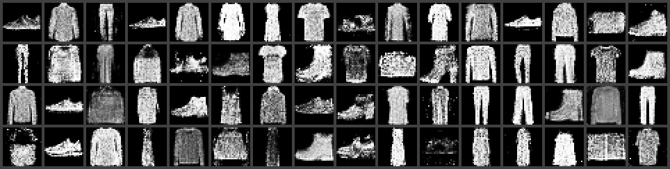
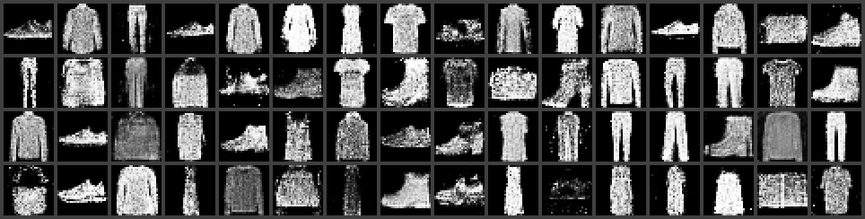

# gan65_chip: Fashion-MNIST approximate-multiplier benchmark

`bench/run_bench.sh [variant]` runs the full `gan65_chip` RTL on generator latents in Verilator, then compares every generated image with a bit-exact Python model of the chip. The only thing a student changes is the multiplier, `rtl/pe/gan_mul8.v`, which all 16 PEs of all three layers use.

## Method
1. **Model.** The 64-256-256-784 MLP generator (ReLU, ReLU, Tanh) was trained on Fashion-MNIST and quantised to per-tensor int8 with static requant multipliers, so one set of CSRs serves every latent (`model/fmnist/quant.json`). Over 8 latents, the int8 output differs from float by 2.18/255 grey levels (MAD).
2. **Latents.** There are 256 latents: z = `torch.randn(256, 64)`, seed 2000, quantised with the model's sZ (`golden/latents.py`, `model/fmnist/latents.memh`).
3. **Chip simulation.** Verilator 5.044 builds `bench/tb/gan65_bench_tb.sv`, a pad-level host that uses only `sclk`/`cs_n`/`io[3:0]`/`hrdy`. It writes the six requant CSRs once. Then, for each latent, it sends START, streams the full 283,984 B (zq + all weights and biases) at SCLK = clk/4 while honouring HRDY, waits for done, checks STATUS and reads the 784 pixels back over RD_PIX_Q. The latents are split across parallel simulations (default nproc-4).
4. **Golden.** `golden/model.py` is the integer model: 24-bit wrapping accumulators, the `e2e_requant` shift/round/saturate and the tanh-ROM binary search, with the ROM parsed from the RTL. `golden/check_ref.py` checks it against the 8 reference vectors of the quantisation flow: 8/8 images, 784/784 pixels each.
5. **Emulation.** For a non-exact variant, iverilog derives the variant's 256x256 product table from its Verilog. The golden model is then rerun with that table. If the RTL output equals this emulation, the run measured the multiplier and not a harness fault.
6. **Scoring** (`bench/score.py`, on uint8 grey levels):
   - bit-exact images and pixels against the exact golden;
   - PSNR against the golden, computed over all pixels, with worst and median per image (inf when exact);
   - MAE and maximum absolute error;
   - label agreement: `classifier/fmnist_cnn` labels each RTL image and the matching golden image, and the score counts equal labels. The classifier is a 2-conv CNN with 91.35 % accuracy on the Fashion-MNIST test set, trained in 23 s on one A40.

## Memory model
`rtl/mem/dla_sram_1rw_256x8.v` is the synthesis memory: a latch RF with one ICG per word, 2,048 clock gates in total. It simulates 130-170x slower (136-170 s per image in Verilator against about 1 s), so the benchmark defaults to `rtl/mem/dla_sram_1rw_256x8_sim.v`, a flip-flop array with the same cycle behaviour. Two checks show the models are equivalent:
- `bench/check_mem.sh`: 200,000 random cycles with a mix of hazard addresses, PASS;
- `run_bench.sh exact --n 16 --latch-rf`: the full chip with the latch RF, 16/16 images bit-exact.

## Results (256 latents, 2026-10-17)
| Variant | Bit-exact images | PSNR (dB) all / worst / median | MAE / max (grey levels) | Label agreement | RTL == emulation |
|---|---|---|---|---|---|
| `exact` (rtl/pe/gan_mul8.v) | 256/256 | inf / inf / inf | 0 / 0 | 256/256 (100 %) | n/a |
| `mq:evo_1KV8` (EvoApprox, exact) | 256/256 | inf / inf / inf | 0 / 0 | 256/256 (100 %) | 256/256 |
| `mq:ilm` | 0/256 | 33.10 / 22.59 / 34.33 | 2.58 / 142 | 250/256 (97.7 %) | 256/256 |
| `example_trunc4` | 0/256 | 24.65 / 19.23 / 25.22 | 8.96 / 135 | 243/256 (94.9 %) | 256/256 |
| `mq:evo_1KR8` | 0/256 | 21.42 / 15.47 / 21.68 | 12.49 / 220 | 224/256 (87.5 %) | 256/256 |
| `mq:evo_1KVL` | 0/256 | 12.19 / 8.26 / 12.40 | 43.33 / 253 | 131/256 (51.2 %) | 256/256 |
| `mq:evo_1KR3` | 0/256 | 8.60 / 7.08 / 8.48 | 86.42 / 240 | 21/256 (8.2 %) | 256/256 |
| `bw_exact`, `booth_exact` (structured exact) | 256/256 | inf / inf / inf | 0 / 0 | 256/256 (100 %) | 256/256 |
| `booth_axfa5` | 0/256 | 32.31 / 25.96 / 33.24 | 3.28 / 80 | 251/256 (98.0 %) | 256/256 |
| `bw_axfa6` | 0/256 | 21.56 / 16.09 / 21.96 | 12.27 / 183 | 236/256 (92.2 %) | 256/256 |
| `booth_akc` | 0/256 | 11.32 / 6.28 / 11.65 | 44.01 / 253 | 166/256 (64.8 %) | 256/256 |
| `booth_trunc5` | 0/256 | 6.31 / 2.93 / 6.61 | 83.85 / 255 | 100/256 (39.1 %) | 256/256 |
| `dralm_t6e` | 0/256 | 30.90 / 20.63 / 32.99 | 3.28 / 164 | 242/256 (94.5 %) | 256/256 |
| `dralm_t6` | 0/256 | 25.61 / 16.82 / 26.72 | 6.77 / 207 | 233/256 (91.0 %) | 256/256 |
| `dralm_t5` | 0/256 | 23.45 / 16.26 / 24.49 | 9.04 / 218 | 231/256 (90.2 %) | 256/256 |
| `dralm_t4` | 0/256 | 19.97 / 12.43 / 21.18 | 13.82 / 251 | 221/256 (86.3 %) | 256/256 |

The full per-variant tables, including classifier confidence, are in `bench/results/<variant>_n256.md`.

Over the 256 latents, the golden labels are: T-shirt/top 14, Trouser 27, Pullover 13, Dress 36, Coat 25, Sandal 18, Shirt 50, Sneaker 27, Bag 21, Ankle boot 25. Mean classifier confidence on the golden images is 0.814.

**Cost.** One image takes 2,346,721 clk, or 93.9 ms at 25 MHz. That covers START, the stream and the readback, and the stream dominates. With the fast memory model, Verilator takes about 1 s of CPU per image. On 44 parallel jobs, 256 images simulate in 12 to 21 s, and the whole `run_bench.sh` takes about 1 min, including the build (about 50 s the first time for each variant) and the scoring.

The image error tracks the multiplier's **bias on the operands the chip actually uses**, not its mean error. Layers 2 and 3 multiply weights by non-negative activations (h0 and h2 lie in [0, 127]), so a signed error that cancels over the full input range can still accumulate over 256 terms per output.

The table below gives each variant's product error over all 65,536 inputs (`bench/mul_table.py`) and over the half with b >= 0:

| Variant | MAE / bias, all inputs | MAE / bias, b >= 0 | PSNR (dB) |
|---|---|---|---|
| `mq:ilm` | 113.7 / 0.0 | 113.7 / 0.0 | 33.10 |
| `example_trunc4` | 6.5 / -6.5 | 6.5 / -6.5 | 24.65 |
| `mq:evo_1KR8` | 32.0 / +0.25 | 31.8 / -31.8 | 21.42 |
| `mq:evo_1KVL` | 101.3 / -16.3 | 112.3 / -112.3 | 12.19 |
| `mq:evo_1KR3` | 2016 / +15.8 | 2000 / -2000 | 8.60 |
| `booth_axfa5` | 6.6 / +0.25 | 6.6 / +0.25 | 32.31 |
| `bw_axfa6` | 12.9 / -10.8 | 12.9 / -10.8 | 21.56 |
| `booth_akc` | 59.8 / -58.6 | 44.4 / -42.6 | 11.32 |
| `booth_trunc5` | 20.0 / -12.25 (+32 when a * b = 0) | 20.0 / -12.25 | 6.31 |
| `dralm_t4` | 302.4 / -0.74 | 315.7 / +30.17 | 19.97 |
| `dralm_t5` | 157.0 / -0.74 | 159.4 / +29.22 | 23.45 |
| `dralm_t6` | 125.2 / -0.73 | 116.6 / +27.26 | 25.61 |
| `dralm_t6e` | 115.4 / +0.02 | 113.8 / -1.60 | 30.90 |

ILM has the largest MAE of the useful variants but no bias, and it gives the best images. Rank candidates with this benchmark, not with the error statistics of the multiplier alone.


*First 64 images, exact multiplier (identical to golden).*


*Same latents with `mq:ilm`.*

## Real-data scores (10,000 RTL images per variant, 2026-10-17)
The golden-referenced scores above measure the distance to the exact chip. The scores in this section measure the distance to real Fashion-MNIST, using the protocol of GAN papers. A GAN has no pixel-paired real image, so every metric here compares distributions or uses nearest neighbours.

**Images.** Each row holds N = 10,000 images. The latents are z = `torch.randn(10000, 64)`, seed 2000, quantised as before. A longer torch draw with the same seed extends a shorter one, so the first 256 latents are exactly the committed `model/fmnist/latents.memh` (`run_bench.sh --n 10000` writes `build/gan65/latents/latents_n10000.memh`). All variant images come from the Verilator chip runs (`run_bench.sh <v> --n 10000`, in chunks of 3,400 latents via `--from/--to`), never from Python. Every non-exact variant matched its Python emulation on 10000/10000 images. The reference rows are:
- the real test set (the floor);
- the float generator `model/fmnist/G300_float.npz` on the unquantised z, with pixels round((tanh + 1) * 127.5);
- the int8 golden model.

**Primary metrics.** These come from torch-fidelity 0.4.0 (`bench/real/fidelity.py`), measured against the full 60k Fashion-MNIST train set:
- FID-10k: Inception-v3 pool3 features (2,048-d), with the TF-ported FID Inception weights;
- IS: Inception-v3 logits, 10 splits, mean ± std;
- KID x10^3: 100 subsets of 1,000, cubic polynomial kernel, mean ± std;
- Precision / Recall (Kynkäänniemi et al. 2019, k = 3): VGG-16 fc2 features, measured against a fixed random train subset of the same size (10k, seed 0).

The 28x28 greyscale uint8 images are copied to 3 channels. torch-fidelity's extractors then resize them with TF1-compatible bilinear interpolation, to 299x299 for Inception and 224x224 for VGG-16.

**Secondary metrics.** These use `classifier/fmnist_cnn` (`bench/real/domain.py`):
- CNN-FID: FID on the CNN's 128-d penultimate features, against the train set;
- NN-PSNR: for each image, the PSNR to its nearest real test image in pixel space;
- NN label agree: how often the label of that nearest real image equals the CNN's label for the generated image;
- CNN-IS: an IS computed with the CNN, maximum 10;
- Conf: the mean maximum softmax;
- Label entropy: the entropy of the label histogram, maximum 3.32 bits.

For the floor row, the NN metrics use the first 10k train images, because the test set is the neighbour pool.

| Images (N = 10000) | FID | IS | KID x10^3 | Precision | Recall | CNN-FID | NN-PSNR mean / median (dB) | NN label agree | CNN-IS | Conf | Label entropy (bits) |
|---|---|---|---|---|---|---|---|---|---|---|---|
| Real test set (floor) | 1.49 | 4.42 ± 0.08 | -0.02 ± 0.14 | 0.772 | 0.774 | 0.19 | 17.24 / 17.17 | 82.5 % | 7.87 | 0.911 | 3.32 |
| Float generator | 77.76 | 3.91 ± 0.07 | 63.80 ± 2.12 | 0.645 | 0.008 | 30.79 | 16.37 / 16.50 | 71.7 % | 6.06 | 0.828 | 3.20 |
| INT8 golden (Python) | 78.65 | 3.90 ± 0.07 | 64.85 ± 2.12 | 0.649 | 0.007 | 31.33 | 16.35 / 16.50 | 71.1 % | 6.04 | 0.828 | 3.19 |
| RTL `exact` | 78.65 | 3.90 ± 0.07 | 64.85 ± 2.12 | 0.649 | 0.007 | 31.33 | 16.35 / 16.50 | 71.1 % | 6.04 | 0.828 | 3.19 |
| RTL `mq:evo_1KV8` | 78.65 | 3.90 ± 0.07 | 64.85 ± 2.12 | 0.649 | 0.007 | 31.33 | 16.35 / 16.50 | 71.1 % | 6.04 | 0.828 | 3.19 |
| RTL `mq:ilm` | 79.17 | 3.89 ± 0.07 | 65.36 ± 2.10 | 0.649 | 0.006 | 31.66 | 16.33 / 16.48 | 71.2 % | 6.03 | 0.827 | 3.19 |
| RTL `example_trunc4` | 87.04 | 3.81 ± 0.07 | 75.50 ± 2.30 | 0.657 | 0.005 | 39.46 | 16.47 / 16.57 | 70.2 % | 5.96 | 0.821 | 3.20 |
| RTL `mq:evo_1KR8` | 88.70 | 3.79 ± 0.07 | 76.37 ± 2.29 | 0.619 | 0.004 | 48.90 | 16.45 / 16.57 | 68.7 % | 5.77 | 0.811 | 3.19 |
| RTL `mq:evo_1KVL` | 131.82 | 3.35 ± 0.08 | 111.77 ± 2.04 | 0.265 | 0.002 | 171.87 | 16.32 / 16.23 | 45.9 % | 3.98 | 0.736 | 2.93 |
| RTL `mq:evo_1KR3` | 304.32 | 1.04 ± 0.01 | 347.52 ± 2.36 | 0.002 | 0.000 | 682.12 | 14.60 / 14.49 | 0.1 % | 1.05 | 0.893 | 0.12 |
| RTL `bw_exact` | 78.65 | 3.90 ± 0.07 | 64.85 ± 2.12 | 0.649 | 0.007 | 31.33 | 16.35 / 16.50 | 71.1 % | 6.04 | 0.828 | 3.19 |
| RTL `bw_axfa6` | 96.90 | 3.73 ± 0.07 | 87.23 ± 2.50 | 0.655 | 0.005 | 46.58 | 16.33 / 16.41 | 69.1 % | 5.83 | 0.815 | 3.19 |
| RTL `booth_exact` | 78.65 | 3.90 ± 0.07 | 64.85 ± 2.12 | 0.649 | 0.007 | 31.33 | 16.35 / 16.50 | 71.1 % | 6.04 | 0.828 | 3.19 |
| RTL `booth_axfa5` | 78.31 | 3.91 ± 0.06 | 64.26 ± 2.15 | 0.643 | 0.007 | 30.39 | 16.25 / 16.39 | 71.0 % | 6.04 | 0.829 | 3.19 |
| RTL `booth_trunc5` | 183.14 | 3.46 ± 0.03 | 179.40 ± 3.22 | 0.033 | 0.000 | 207.02 | 11.23 / 11.16 | 50.4 % | 3.72 | 0.779 | 2.64 |
| RTL `booth_akc` | 133.62 | 3.29 ± 0.03 | 118.82 ± 2.44 | 0.422 | 0.004 | 131.63 | 17.32 / 17.34 | 45.9 % | 4.60 | 0.745 | 3.14 |
| RTL `dralm_t4` | 79.59 | 4.04 ± 0.07 | 61.23 ± 2.09 | 0.578 | 0.008 | 25.68 | 15.60 / 15.70 | 70.7 % | 6.13 | 0.834 | 3.19 |
| RTL `dralm_t5` | 77.12 | 3.98 ± 0.07 | 60.92 ± 2.06 | 0.618 | 0.008 | 26.80 | 16.00 / 16.11 | 70.7 % | 6.08 | 0.832 | 3.19 |
| RTL `dralm_t6` | 75.59 | 3.96 ± 0.05 | 60.37 ± 2.02 | 0.637 | 0.008 | 27.81 | 16.23 / 16.36 | 71.4 % | 6.07 | 0.830 | 3.19 |
| RTL `dralm_t6e` | 79.04 | 3.92 ± 0.07 | 64.70 ± 2.17 | 0.645 | 0.007 | 30.78 | 16.25 / 16.38 | 71.1 % | 6.05 | 0.828 | 3.19 |

- **The exact and EvoApprox-exact `mq:evo_1KV8` chips score the same as the int8 golden.** int8 quantisation costs 0.9 FID against the float generator (77.76 to 78.65).
- **`booth_axfa5` scores like exact** (FID 78.31 vs 78.65; KID 64.26 ± 2.15 vs 64.85 ± 2.12); `bw_axfa6` costs 18 FID, about twice trunc4, because of its -10.8 bias per product. The structured exact `bw_exact` / `booth_exact` reproduce the golden scores.
- **The Aizaz & Khare truncated Booth variants are far off** (`docs/papers/aizaz_khare_2022.md`): `booth_akc` (TACBM, w = 6) FID 133.6, about `mq:evo_1KVL`, from its -43 bias per product at b >= 0; `booth_trunc5` FID 183.1, because its constant compensation (+32) also lands on the many zero products (ReLU zeros), which no other variant here disturbs.
- **The Yin et al. DR-ALMs score at or below exact on FID** (`docs/papers/yin_2021_dralm.md`): `dralm_t6` 75.6, `dralm_t5` 77.1, `dralm_t4` 79.6, `dralm_t6e` 79.0 (exact 78.65), although their PSNR vs golden is only 20-31 dB and the paper-sign versions carry a +27..+30 bias per product at b >= 0. Precision drops with the truncation (0.578 for t = 4 vs 0.649) while IS and KID improve slightly, so the lower FID reflects a change in the spread of the samples, not higher fidelity to the golden images.
- **`mq:ilm` is almost free on real-data metrics** (+0.5 FID). `example_trunc4` and `mq:evo_1KR8` cost about 8-10 FID. `mq:evo_1KVL` is clearly degraded (FID 132, precision 0.27). `mq:evo_1KR3` collapses: the CNN puts 99 % of its images in one class (entropy 0.12 bits), and the near-chance IS of 1.04 says the same.
- **The ranking is the same as with the golden-referenced PSNR**, but the gaps are on the scale a GAN paper would report. The GAN, not the multiplier, dominates the distance to real data: the floor is 1.49 FID, against 78.65 for the exact chip.
- **Recall is close to 0 for every generator, including float.** This MLP GAN covers little of the real VGG-16 manifold, because of mode coverage and its speckle texture. A low recall here is a property of the model, not of the hardware.
- **NN-PSNR barely separates the useful variants** (16.3-16.5 dB). It does not reward fidelity to the data distribution: `example_trunc4`'s slightly darker images sit marginally closer in pixel space. Treat it as a sanity check only.

**Cost.** On 44 jobs, the RTL runs take 434-479 s per variant for the behavioural multipliers and 814 s for `mq:evo_1KR3`. The EvoApprox gate netlists 1KV8, 1KR8 and 1KVL take 2,296-2,612 s, in three chunks of under 15 min each. Scoring takes about 100 s per row on one A40 (cuda:1). The train-set features are cached in `build/gan65/fidelity_cache`.

## Reproduce
```bash
python3 -m src_gan_tsmc65.golden.check_ref
src_gan_tsmc65/bench/check_mem.sh
for v in exact mq:evo_1KV8 mq:ilm example_trunc4 mq:evo_1KR8 mq:evo_1KVL mq:evo_1KR3 bw_exact bw_axfa6 booth_exact booth_axfa5 booth_trunc5 booth_akc dralm_t4 dralm_t5 dralm_t6 dralm_t6e; do src_gan_tsmc65/bench/run_bench.sh $v; done
src_gan_tsmc65/bench/run_bench.sh exact --n 16 --jobs 16 --latch-rf
pip install torch-fidelity==0.4.0                    # real-data metrics (weights download on first use)
src_gan_tsmc65/bench/run_real.sh                     # 10k RTL images x 7 variants + scores (~3 h)
python3 -m src_gan_tsmc65.classifier.train          # retrain the classifier (cuda:1, ~25 s)
```
