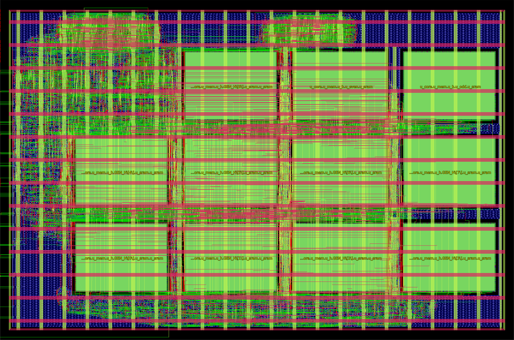

# mq_chip physical signoff

**Status (2026-10-14):**
- `mq_chip` is hardened and signed off in run `src_int8/flow/runs/mq_final` (LibreLane 3.0.14 Classic, gf180mcuD open_pdks 7b70722e + `gf180mcu_as_sc_mcu7t3v3`, `src_int8/flow/build.sh mq_final`). Same quality bar and the same flow as the FP16 `mb_chip` (`src/docs/signoff.md`); every script is a copy of its `src/flow` twin, adapted.
- 9-corner STA 0 violations (setup, hold, slew, cap). Magic DRC / KLayout main / antenna / Vn.2b / LVS / XOR / antenna all 0.
- Metal fill: `final/gds_filled/mq_chip.gds` is KLayout main/antenna/Vn.2b clean, `check_fill.py` and the PDK dummy decks pass; block-level M2/M4 density is the DRM ceiling as for `mb_chip`.
- Zero-delay GLS, timing-annotated GLS (CVC, SDF) and activity-based power: see the sections below. Zero-delay GLS `nl` + `pnl` PASS (31 / 31 tokens, 450,412 clk/token = RTL); SDF GLS PASS in all 3 corners (31 / 31 tokens, 0 timing-check violations, 100 % annotation).
- Not committed. Run directories are git-ignored.



`mq_chip_layout.png` is the OpenROAD render of `final/odb` (`src_int8/flow/report/render.tcl`). LibreLane's KLayout render, with fill included, is `runs/mq_final/final/render/mq_chip.png`.

## Floorplan
- **Die and core:** the same as `mb_chip` / `dla_fp16_chip`. Die 1675 x 1110 um, core [40, 40, 1635, 1070], `A56_ACV.def` west-edge pin template, DVDD/DVSS core ring and power-pin weld (`librelane/connect_power.py`). The die did not grow.
- **Macros:** 11 x `gf180mcu_ocd_ip_sram__sram256x8m8wm1` (301.3 x 224.9 um, pins on the south edge), all orientation N, on the `mb_chip` grid (columns x = 244.90 / 601.20 / 957.50 / 1313.80, rows y = 157.57 / 437.50 / 717.43, 55 um channels). The third row now holds 3 macros instead of 2.

| Row | y (um) | Instances |
|---|---|---|
| 2 (top) | 717.43 | HMEM `u_core.u_mem.u_h.GEN_H[8].u_sram.u_sram`, BMEM `u_core.u_mem.u_b.u_even.u_sram`, `u_core.u_mem.u_b.u_odd.u_sram` (three east columns) |
| 1 | 437.50 | HMEM `GEN_H[4..7]` |
| 0 | 157.57 | HMEM `GEN_H[0..3]` |

- **Standard cells** sit in the NW pocket (x 40..~590, y 717..1070), the ~205 um west channel next to the pins and the 117 um strip under row 0 (row-0 pin escape), plus the macro channels. Placement density 50 % (unchanged); std-cell utilisation of the free area is 36.6 %.

## Flow deltas vs the FP16 flow (`src/flow/config.yaml`)
Unchanged: die, core, template, PDN (`librelane/pdn_cfg.tcl`), routing obstruction, 40 ns clock, IO delays (20 %), 0.25 ns uncertainty, 5 % derate; antenna settings (no heuristic diodes, GRT margin 75, `DRT_ANTENNA_REPAIR_ITERS=3`, `JUMPER_ONLY=false`); PnR SDC 0.9 ns / 0.12 pF, signoff SDC 1.5 ns + liberty per-pin max_capacitance; post-GPL repair 40/40 %, 500 um wire buffering, CTS clusters 12 / 50 um; post-CTS resizer hold repair (margin 0.1 ns, all corners, propagated clock).

Changed:
- **RTL and macros:** `src_int8/rtl/chip.f` (+ include dirs `nonlin/`, `seq/`), 11 macro instances (above).
- **Post-GRT repair slew margin 40 % instead of 30 %** (`GRT_DESIGN_REPAIR_MAX_SLEW_PCT`). The first run (`mq_r0`, 30 %) was clean except for one fanout-1 `aoi211_2` net (`_10653_/Y` -> `_10678_/C`) at 1.522 ns slew at max_ss (limit 1.5 ns). The repair sizes with tt-corner / GRT parasitics, so the margin has to cover the ss + max-RC spread. With 40 %, `mq_final` has 0 slew violations in all 9 corners; everything else (cells +86, diodes +82) is within noise of `mq_r0`.

**SRAM CEN hold (pre-layout -1.78 ns, `syn/`; macro hold 2.94 ns at ss).** Fixed as in FP16 by the post-CTS resizer hold repair: 244 hold buffers. Routed SPEF slack on SRAM CEN: +0.949 ns at max_ss (`GEN_H[2]`), +1.089 ns at min_ff.

## Signoff metrics: `mq_final` vs `mb_chip` (`src/flow/runs/mb_final`)

| Metric | mq_chip (mq_final) | mb_chip FP16 (mb_final) |
|---|---|---|
| SRAM macros | 11 (745,485 um^2) | 10 (677,714 um^2) |
| Std cells, excl. 32,586 fill (incl. 6,839 tap/endcap) | 20,625 | 16,967 |
| Std-cell area | 323,957 um^2 | 244,062 um^2 |
| Flops / hold buffers / repair buffers / diodes | 803 / 244 / 2,231 / 2,239 | 672 / 280 / 1,656 / 1,395 |
| Clock buffers / inverters | 285 / 89 | - |
| Utilisation, incl. macros (std cells only) | 65.6 % (36.6 %) | 56.5 % (25.6 %) |
| Routed wirelength | 973.5 mm | 673.6 mm |
| Worst setup, SPEF, 9 corners | **+14.11 ns** (max_ss_125C_3v00, `u_seq.pc[2]` -> multiplier -> `u_dp.u_wb.prod[40]`) | +18.35 ns |
| Setup slack per corner (ns) | max_ff +24.78, max_ss +14.11, max_tt +20.70, min_ff +25.63, min_ss +15.55, min_tt +21.78, nom_ff +25.24, nom_ss +14.89, nom_tt +21.28 | nom_tt +24.69 |
| Worst hold, SPEF, 9 corners | **+0.106 ns** (min_ff_n40C_3v60, `u_seq.u_rf.r[6][10]` enable loop) | +0.104 ns |
| Hold slack per corner (ns) | max_ff +0.11, max_ss +0.36, max_tt +0.21, min_ff +0.11, min_ss +0.35, min_tt +0.20, nom_ff +0.11, nom_ss +0.35, nom_tt +0.20 | max_ss +0.35 |
| Setup / hold violations, all 9 corners | 0 / 0 | 0 / 0 |
| Max-slew violations @ 1.5 ns / max-cap (liberty limits), all corners | 0 / 0 | 0 / 0 |
| Max-fanout (limit 9, not a signoff criterion) | 75 per corner | 42 |
| Clock skew, worst setup / hold (`76-openroad-stapostpnr`, `clock__skew__worst_*`) | 0.54 / -0.57 ns | 0.45 / -0.54 ns |
| Power, vectorless (LibreLane `power__total` = max_ss corner) | 16.2 mW | 19.4 mW |
| Power, nom tt, SDF-GLS activity (SAIF) | **27.9 mW = 503 uJ/token** (31.6 mW with the flop proxy); ff 33.1, ss 23.3 mW | 18.2 mW = 583 uJ/token |
| Magic DRC / illegal overlap / LVS / XOR | 0 / 0 / 0 (match) / 0 | 0 / 0 / 0 / 0 |
| OpenROAD antenna (post-DRT) / route DRC | 0 nets, 0 pins / 0 | 0 / 0 |
| KLayout DRC main / antenna / Vn.2b (unfilled GDS, `drc/kdrc.sh`) | **0 / 0 / 0** (same on `mq_r0`) | 0 / 0 / 0 |
| KLayout density, block bbox, unfilled / filled | 5 items (M1.4, M2.4, M4.4, M5.4, MT.3 < 30 %; M3 passes) / 2 items (M2.4, M4.4, see below) | 6 / 2 items |
| GLS of routed netlist (31 tokens x 128 logits + host image) | **nl + pnl PASS** (31 / 31 tokens, 450,412 clk/token = RTL; 3.0 h / 2.6 h); SDF GLS **PASS** min / typ / max, 0 timing-check violations | nl + pnl PASS |
| Pre-layout synthesis (`syn/synth_chip.sh`) | 8,054 cells, 213,946 um^2, ss slack +14.87 ns | - |
| Run time, PnR + signoff STA | ~19 min | ~15 min |

The pre-layout -> placed std-cell area ratio (1.51x) is the same as for FP16 (1.49x); the growth is repair buffers, hold buffers, diodes and tap cells.

## Gate-level simulation
`src_int8/flow/gls/run_gls.sh [nl|pnl]` runs `src_int8/tb/chip/tb_mq_chip.sv` on the routed netlist (zero-delay Icarus, gf180mcu_as_sc_mcu7t3v3 cell models, behavioural SRAM model). Vectors: the RTL chip-TB default set, 2 stories, 31 tokens, state reset between them, logits bit-exact per token and the host image (H slots + BMEM, 3,520 bytes) after the last token of each story.

| Netlist | Result | Cycles/token (START->done) | Wall time |
|---|---|---|---|
| `final/nl` | **PASS**: 31 tokens x 128 logits bit-exact, 2 state resets, 2 host-image read-backs (`flow/build/gls_nl/gls.log`, `flow/logs/gls_nl.log`) | 450,412 (same as RTL; 455,312 incl. status + logit readback) | 3 h 03 min (10,971 s) |
| `final/pnl` | **PASS**: 31 tokens x 128 logits bit-exact, 2 state resets, 2 host-image read-backs (`flow/build/gls_pnl/gls.log`, `flow/logs/gls_pnl.log`) | 450,412 | 2 h 34 min (9,259 s) |

RTL reference (`tb/run_chip.sh`, `docs/verification.md`): 450,412 clk per token START->done with the zero-delay host = 18.016 ms at 25 MHz; the GLS matches it exactly. The SDF TB (`tb/sdf/`, pads driven with the SDC input / output timing) measures 450,608 per token (+195 clk over the 387 HRDY waits of the stream, +1 clk tail), 18.024 ms, which is the value the power section uses.

## Timing-annotated GLS
`src_int8/flow/sdf_gls/run_sdf_gls.sh <corner>`: the routed `final/nl` with the corner's SDF and every timing check active, Open Source CVC 7.00b with the two SDF-reader fixes (`tools/cvc_sdf.patch`), the generated std-cell models with specify blocks (`models/gen_cells.py`), the SRAM model with 3.3 V Liberty specparams and unconditional CEN checks (`models/sram_sdf.v`), the model self-test (`checks/model_selftest`, incl. the zero-CLK->Q MIPD test) before every run. Everything is as described in `src/docs/signoff.md` ("Timing-annotated GLS"); only the TB (`src_int8/tb/sdf/tb_mq_chip_sdf.v`, 11 macros in `sram_mon.vh`) and the vectors differ. The SDF written by `sdf/write_sdf.tcl` is byte-identical (except the date) to LibreLane's `76-openroad-stapostpnr/<corner>/mq_chip__<corner>.sdf`, and its STA reproduces the signoff slacks (min_ff hold +0.1062, max_ss setup +14.111, nom_tt +21.277 / +0.204 ns).

Annotation coverage (identical in every corner, `coverage.rpt`): 61,866 SDF statements, 61,866 annotated (100 %); 11,320 instances with timing arcs, all in the SDF; 4,389 model timing checks, all with an SDF value.

| Corner (SDF values) | Tokens bit-exact | Timing-check violations | SRAM model errors | Output-timing violations (worst output settle after clk, limit 32 ns) | SDF coverage | Sim time |
|---|---|---|---|---|---|---|
| **min_ff_n40C_3v60** (min) | **31 / 31** | **0** | 0 | 0 (3.58 ns) | 100 % | 4.3 h (15,474 s) |
| **nom_tt_025C_3v30** (typ) | **31 / 31** | **0** | 0 | 0 (4.62 ns) | 100 % | 4.4 h (15,931 s) |
| **max_ss_125C_3v00** (max) | **31 / 31** | **0** | 0 | 0 (6.32 ns) | 100 % | 4.5 h (16,179 s) |

All three corners: 450,608 clk per token START->done, 2 state resets, 2 host-image read-backs; 31 x `128/128 logits bit-exact` per log. Artefacts: `flow/build/sdf_gls/<corner>/{gls.log,timing.rpt,coverage.rpt}`, verdicts `flow/build/sdf_gls/logs/full_<corner>.log`, table of all runs (incl. the power and negative-test runs) `flow/build/sdf_gls/summary.rpt` (`checks/summarize.py`). About 8.5 min per token in CVC, the three corners run concurrently.

### Negative tests (the checks fire)
2-token story "On", `NTOK=1`, `MAXCYC=300000`:

| Test | Edit | Result |
|---|---|---|
| SRAM hold, min_ff | `GEN_H[0]` CLK pin +2.0 ns (`SKEW`) | **628 violations**, 596 SRAM error messages (vendor-model X), run stopped at MAXCYC: fires |
| Setup, max_ss | clock 16 ns (STA at 22 ns already has WNS -3.889 ns) | **3,299,989 setup violations**, 3,276,916 SRAM errors: fires |
| Setup, max_ss, clock 22 ns | STA WNS -3.889 ns on the `pc -> multiplier -> prod` path | **does not fire** in 300k clk: the STA-worst path is data-dependent (Booth multiplier) and the STA margin includes 0.25 ns uncertainty + 5 % derate; the observed setup margin of the token is 19.3 ns (probe below), i.e. the exercised paths are > 2 ns faster than the STA worst case. The STA stays the authority. |
| Flop hold, min_ff | `_16667_.CLK` (`u_host.tx_cnt[1]`) +0.56 ns (observed margin 0.542 ns, limit 0.011 ns) | **20 hold-window violations** on `_16667_` (`$setuphold`, posedge D): fires |

### Observed margins (`checks/margin_probe.py`)
| Probe | Corner | Result |
|---|---|---|
| HOLD +3.0 ns | min_ff | 1,631 checks reported (11.6 M reports); **worst observed hold margin +0.542 ns** at `_16667_` (`u_host.tx_cnt[1]`, posedge D); next `_16618_` +0.543 ns. STA worst hold +0.106 ns (`u_rf.r[6][10]`) is a register-file enable loop not among the reported worst; checks never reported have >= 3 ns. Consistent with FP16 (+0.447 ns observed vs +0.104 ns STA): the sim margin = STA slack + uncertainty + derate. |
| SETUP +22.0 ns | max_ss | 151 checks reported; **worst observed setup margin +19.344 ns** at `_15913_` (`u_dp.u_wb.y[0]`, negedge D). STA worst +14.11 ns (`u_wb.prod[40]`, data-dependent multiplier path) was not hit by the token. |

## Activity-based power
`src_int8/flow/power/run_power.sh`: SDF GLS of token 1 ('n') of the story "On" per corner with a VCD of all `mq_chip` nets, per-pin SAIF (`activity/vcd2saif.py`), OpenSTA `report_power` on the signoff netlist / SDC / SPEF (`report/power.tcl`), plus the vectorless and zero-delay references and the flop power proxy (`report/proxy_lib.py`). Energy per token = power x the START->done time of the GLS (18.02 ms).

| nom corner, SAIF activity [mW] | Sequential | Combinational | Clock | Macro (11 SRAM) | Total | Energy/token |
|---|---|---|---|---|---|---|
| **tt 25C 3.30 V** (internal / switching / leakage) | 0 / 0.077 / 0 | 5.372 / 3.139 / 0 | 11.322 / 5.815 / 0 | 2.166 / 0 / 0.0016 | **27.89** (18.86 / 9.03 / 0.0016) | **503 uJ** |
| ff -40C 3.60 V | 0.090 | 10.141 | 20.236 | 2.593 | **33.06** | 596 uJ |
| ss 125C 3.00 V | 0.064 | 7.060 | 14.336 | 1.835 | **23.29** | 420 uJ |

| tt comparison | Total | Energy/token | Note |
|---|---|---|---|
| SAIF, SDF GLS (above) | 27.89 mW | 503 uJ | |
| SAIF, zero-delay GLS (`NOSDF=1`) | 24.50 mW | 442 uJ | glitches are 3.4 mW (12 % of the total; FP16: 3 %), mostly in the Booth multiplier |
| vectorless (LibreLane default activity) | 18.89 mW | 340 uJ | under-estimates: the multiplier toggles every cycle in operation |
| SAIF + flop power proxy | 31.59 mW | 569 uJ | estimate of the flop internal power the Liberty lacks (+3.7 mW) |

Activity window: token 1 incl. status + readback, 455,508 clk = 18.22 ms; SAIF annotated pins 39,631 (145 unannotated = dangling CTS `clkload` outputs, as in FP16), all nets annotated. SRAM check: TB counts 55,938 reads + 3,736 writes over the 11 macros x Liberty energies = 2.235 mW vs OpenSTA Macro 2.167 mW (3 %). Pad power 0 (no IO cells in the block).

**Breakdown at tt.** Clock 61 % (17.1 mW: 803 flop CLK pins, 11 SRAM CLK pins, 285 + 89 CTS cells), combinational 31 % (8.5 mW: the shared 24 x 17 Booth multiplier and the writeback shifter switch on every MAC), SRAM 8 % (2.2 mW). Compared with FP16 `mb_chip` (18.2 mW / 583 uJ): the INT8 chip draws 1.5x the power but a token takes 0.56x the time (18.0 vs 32.0 ms), so the energy per token is 14 % lower (503 vs 583 uJ) with half the stream.

**Library caveats** (the same as for `mb_chip`, they affect the absolute numbers):
- `gf180mcu_as_sc_mcu7t3v3` has no flop internal power and no leakage: "Sequential internal" is 0; the fd_sc 7t5v0 `dffq/dffrsnq` proxy adds an estimate (`saif_proxy` rows of `build/power/summary.rpt`).
- The SRAM Liberty very likely double-counts the access energy (the same datasheet number on rise and fall of CLK); the datasheet value would roughly halve the macro share. The 3.3 V table is inherited from the 5 V characterisation.
- Activity is one representative token; every token runs the same microcode and streams the same 54,280 bytes.

## Metal fill and density
`src_int8/flow/fill/fill_all.sh mq_final` (= `fill.sh` + `fill_sta.sh` + `fill_signoff.sh`, the `src/flow/fill` generator and checks with the cell prefix `mq_chip_*` and the 11 macro keep-outs). Deliverable: `runs/mq_final/final/gds_filled/mq_chip.gds`.

| Check | Result |
|---|---|
| Fill added (`gen/fill.py`) | 169,738 squares: M1 23,454 (5.05 % of bbox), M2 19,984 (4.30 %), M3 31,158 (6.70 %), M4 28,269 (6.08 %), M5 66,873 (14.39 %) |
| `check_fill.py` (XOR of non-dummy layers, floating squares, DM.1/2b/3/4-7/8 vs drawn metal) | **ALL PASS** |
| PDK dummy decks DM1-DM5 | **0 items** |
| KLayout main / antenna / Vn.2b on the filled GDS | **0 / 0 / 0** |
| KLayout density, block bbox (filled) | 2 items (M2.4 26.40 %, M4.4 21.67 %): the DRM-legal ceiling, same two layers as `mb_chip` (see `src/docs/signoff.md`); M1 34.16, M3 39.80, M5/MT 30.14 % pass |
| Die-model density (A56 padring + block, rest empty) | 1 item, M1.4 29.86 % (unfilled 28.77 %): cleared by >= 0.4 % Metal1 anywhere else on the die (FP16: 29.51 %); M2-M5, COMP, Poly2 pass |
| Magic DRC on the filled GDS / illegal overlap / GDS-extracted LVS vs `final/pnl` (`mq_final_fillsignoff`, `MAGIC_EXT_USE_GDS`) | **0 / 0 / 0 errors (match)** |
| STA with grounded fill (`mq_final_fillrc`, upper bound): worst setup / hold, 9 corners | **+14.058 ns** (max_ss, -53 ps vs unfilled) / **+0.106 ns** (min_ff, unchanged); 0 setup / hold / slew / cap violations |

## Open items
- Fanout: 75 max-fanout items per corner (limit 9) are reported but are not a signoff criterion (FP16: 42).
- Reset recovery/removal of the `dfsrtp_2` flops is not covered by STA or the SDF (no arcs in the AS Liberty); the GLS uses placeholder `$recrem` limits, as in FP16.
- Power is model-limited (see the caveats above).
- Organiser confirmation of the filled-GDS deliverable is pending, as for `mb_chip`.

## Reproduce
```
source src_int8/flow/env.sh
src_int8/flow/build.sh mq_final                      # ~19 min
python3 src_int8/flow/report/report.py mq_final
src_int8/flow/drc/kdrc.sh mq_final                   # ~8 min
src_int8/flow/fill/fill_all.sh mq_final              # fill + checks + KLayout DRC, RCX/STA with fill, Magic DRC + LVS on the filled GDS
src_int8/flow/gls/run_gls.sh nl & src_int8/flow/gls/run_gls.sh pnl &
python3 -m src_int8.golden.vectors src_int8/flow/build/sdf_gls/vec_31 --chip-only
for c in min_ff_n40C_3v60 nom_tt_025C_3v30 max_ss_125C_3v00; do
    VEC=src_int8/flow/build/sdf_gls/vec_31/chip src_int8/flow/sdf_gls/run_sdf_gls.sh $c & done; wait
python3 src_int8/flow/sdf_gls/checks/summarize.py src_int8/flow/build/sdf_gls
src_int8/flow/power/run_power.sh
```
